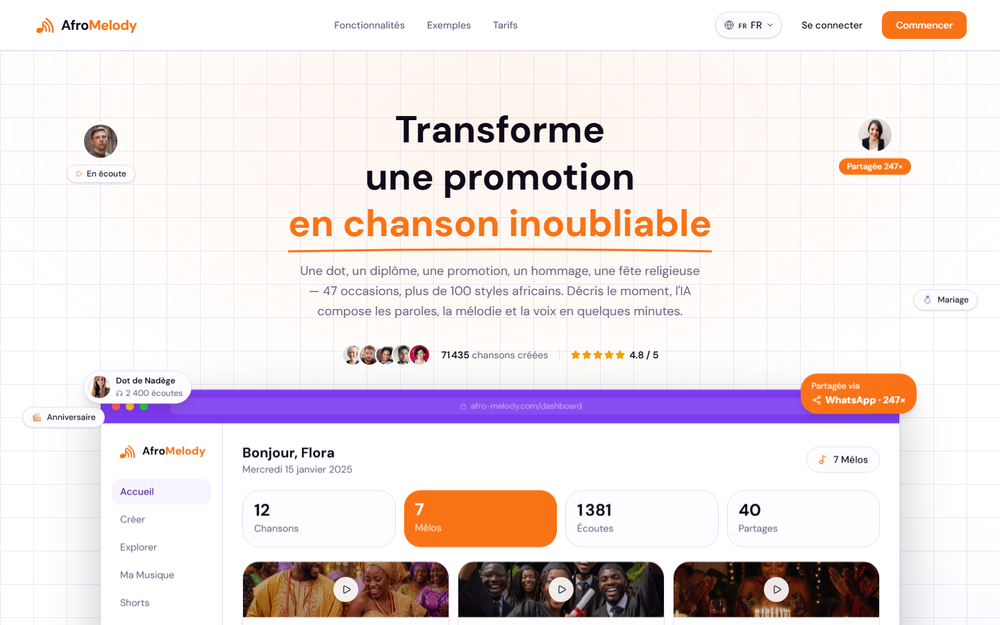
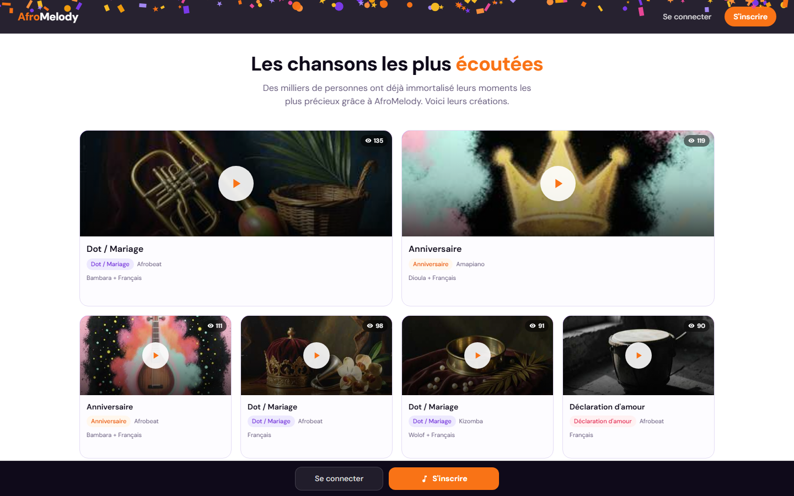
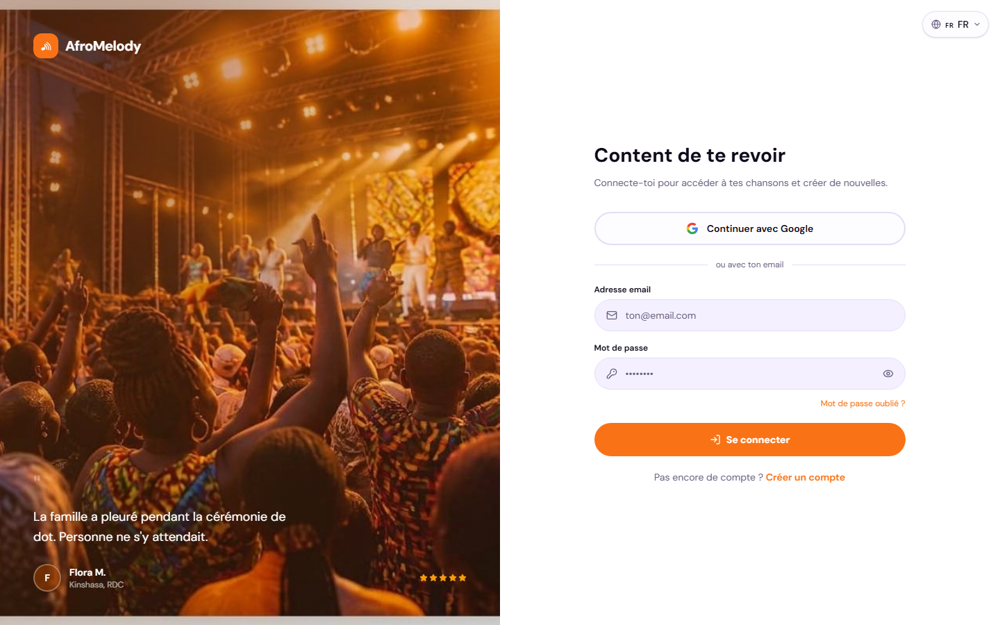

  

<h1 align="center">AfroMelody</h1>

  <strong>Transforme tes moments de vie en chanson africaine personnalisée, composée par l'IA.</strong>

  <a href="https://www.afro-melody.com"><strong>🌐 www.afro-melody.com</strong></a>

  

---

## Présentation

AfroMelody est une application web qui crée des **chansons personnalisées dans les styles musicaux africains** pour les moments importants : dot, mariage, naissance, anniversaire, diplôme, hommage, promotion d'une entreprise…

L'utilisateur décrit le moment en quelques phrases. L'application écrit les paroles, compose la musique et produit une chanson chantée, prête à partager sur WhatsApp ou sur les réseaux sociaux.

**Objectif :** rendre la création musicale personnalisée accessible au public africain francophone. Nous avons donc mis l'accent sur les styles locaux, les paroles en langues africaines, le paiement par Mobile Money et un usage pensé d'abord pour le téléphone.

## Fonctionnalités principales

- 🎶 **Génération de chansons par IA** : paroles, mélodie, voix et mixage en quelques minutes
- 🌍 **Plus de 100 styles africains** : Rumba, Afrobeat, Amapiano, Coupé-décalé, Makossa, Mbalax, Afro Zouk, Gospel…
- 🗣️ **Paroles en français et en langues locales** : bambara, dioula, wolof, lingala, yoruba, swahili, haoussa, baoulé, ewe, ewondo, sango, kinyarwanda
- 🎉 **47 occasions**, de l'intime au professionnel
- 💳 **Crédits « Mélos » payables par Mobile Money** (Orange Money, Wave, MTN…)
- 🎬 **Clips vidéo courts (Shorts)** générés automatiquement pour les réseaux sociaux
- 🔗 **Pages de partage** de chaque chanson, et page personnalisée en Mode Premium
- 🔍 **Explorer et Découvrir** : écouter les créations de la communauté avant de créer la sienne
- 🔐 **Comptes utilisateurs** : inscription par email avec code de vérification, ou connexion Google
- 📧 **Emails automatiques** : bienvenue, suivi de commande, relances
- 🛠️ **Back-office d'administration** : utilisateurs, commandes, paiements, journal d'audit

## Captures d'écran

| Découvrir les chansons de la communauté | Connexion |
|---|---|
|  |  |

  
  
  
  

## Technologies et API utilisées

**Application**
- **Next.js 16** (App Router), **React 19**, **TypeScript**, **Tailwind CSS v4**
- **Prisma** + **PostgreSQL** hébergé sur **Neon**
- **Upstash Redis** : limitation de débit et coordination des tâches
- Tests unitaires avec **Vitest**, et **ESLint** et **Prettier** pour la qualité du code

**Intelligence artificielle et audio**
- **Suno API** : génération des chansons (musique et voix)
- **Claude (Anthropic)** et **Gemini (Google)** : écriture des paroles
- **Replicate** (Demucs, WhisperX) : séparation voix et instruments, synchronisation des paroles
- **Hugging Face** (Seed-VC) : clonage vocal, en cours de développement
- **Remotion Lambda** (AWS) : génération des clips vidéo

**Services**
- **Moneroo** : paiements Mobile Money
- **Resend** : envoi des emails
- **Cloudinary** : stockage des images et médias
- **Google OAuth** : connexion avec Google
- **Sentry** : suivi des erreurs en production
- **Vercel** : hébergement, déploiement et tâches planifiées (Cron)

## Ma contribution

J'ai développé AfroMelody en binôme avec **Sossoukpè Barack Oren**. Nous avons défini ensemble le produit et la conception : idée, parcours utilisateur et fonctionnalités.

**Mes responsabilités principales :**
- **Développement** des fonctionnalités : interface, pages de l'application, création de chansons, intégrations
- **Marketing et contenu** : textes du site, emails, communication sur les réseaux sociaux

**Utilisation de l'IA, en toute transparence :** une grande partie du code a été écrite avec **Claude Code**, un assistant de programmation basé sur l'IA. Dans l'historique Git, plus de la moitié des commits sont co-signés par Claude. Mon rôle consistait à décrire précisément chaque fonctionnalité, guider l'assistant, relire et tester le résultat, corriger les problèmes et décider de ce qui partait en production.

Le socle technique (authentification, paiements, back-office, tâches planifiées) provient d'un **kit de démarrage Next.js existant**, que nous avons adapté et enrichi pour AfroMelody.

## Travail en équipe et déploiement

- **Deux développeurs**, chacun avec son propre poste et son propre assistant Claude Code
- Chacun travaillait sur **sa propre branche Git**, puis le travail était fusionné dans la branche principale `main`
- **Conventions partagées** : messages de commit normalisés (Conventional Commits), et vérifications du formatage, du lint, du typage et des tests avant chaque envoi
- **Base de données commune** : un script bloque toute mise à jour du schéma si le code local n'est pas à jour, pour éviter d'écraser le travail de l'autre
- **Secrets** (clés d'API) jamais dans Git : partagés entre nous par un canal privé
- **Déploiement sur Vercel**, avec le nom de domaine **afro-melody.com**, et vérifications automatiques (CI GitHub Actions)
- **Suivi en production** avec Sentry et des tâches planifiées (génération des chansons et des vidéos, envoi des emails, nettoyage)

## Installation

Ce dépôt est une **vitrine de présentation** : le code source d'AfroMelody est **privé** et ne peut pas être lancé depuis ce dépôt.

Pour essayer l'application, rendez-vous sur **[www.afro-melody.com](https://www.afro-melody.com)**.

---

© AfroMelody. Tous droits réservés.

