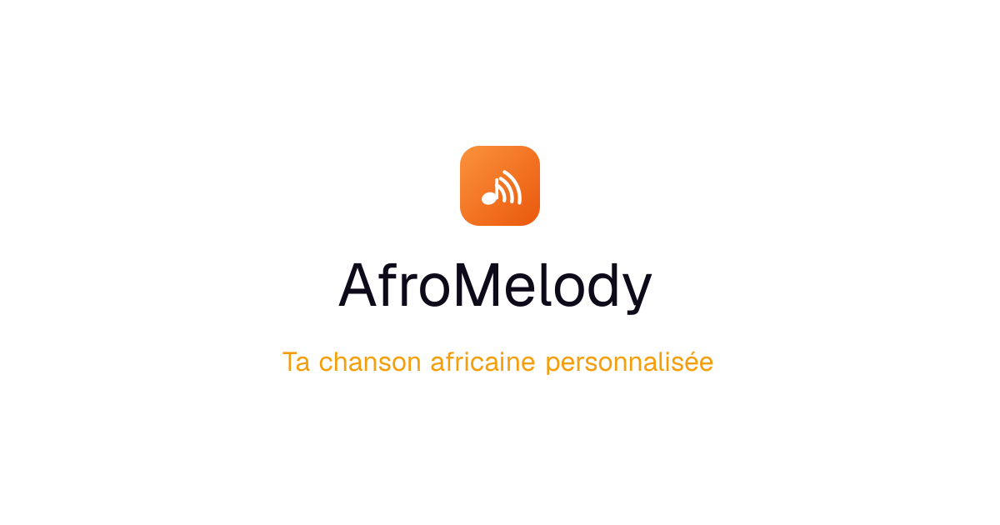

  

<h1 align="center">AfroMelody</h1>

  <strong>Transforme tes moments en chanson africaine inoubliable.</strong> 
  Mariage, dot, naissance, anniversaire, diplôme : décris le moment, l'IA compose la chanson.

  <a href="https://www.afro-melody.com"><strong>👉 Essayer sur afro-melody.com</strong></a>

  

---

## Comment ça marche

| 1. Décris le moment | 2. L'IA compose pour toi | 3. Partage, fais-la vivre |
|---|---|---|
| Choisis l'occasion parmi 47 possibilités et raconte ce que tu as en tête. Pas besoin d'écrire des paroles. | Paroles, mélodie, voix, mixage : tout est généré en quelques minutes, dans le style choisi. | Par WhatsApp, sur les réseaux, ou comme hymne, jingle ou bande-son d'un événement. |

## Pourquoi AfroMelody

> Les générateurs de musique classiques font de la musique générique. AfroMelody crée **ton souvenir**.

- 🎶 **Plus de 100 styles africains** : Rumba congolaise, Afrobeat, Amapiano et bien d'autres
- ✍️ **Paroles 100 % en français**, écrites à partir de ton histoire
- ⚡ **Prête en moins de 5 minutes**
- 🎉 **47 occasions**, de l'intime au professionnel
- 📱 **Paiement par Mobile Money**, sans carte bancaire
- 🎬 **Clips prêts pour les réseaux sociaux** (format Shorts)
- 💎 **Page personnalisée** pour offrir la chanson en Mode Premium
- 🎤 **Clone vocal** : bientôt disponible

## Pour tous les moments qui comptent

  
  
  
  

## Sous le capot

Une application web moderne, pensée pour le mobile et pour l'Afrique francophone :

- **Next.js** et **React** pour une application rapide, installable sur téléphone (PWA)
- **Génération musicale par IA** : paroles, composition, voix et mixage
- **Paiements Mobile Money** sécurisés (Orange Money, Wave, MTN MoMo…)
- Hébergement cloud, partage optimisé pour WhatsApp et les réseaux sociaux

> ℹ️ Ce dépôt est une **vitrine de présentation**. Le code source de l'application est privé.

## Contact

- 🌐 Site : [afro-melody.com](https://www.afro-melody.com)
- 💬 Une question, un partenariat ? Écris-nous depuis le site.

---

© AfroMelody. Tous droits réservés.

